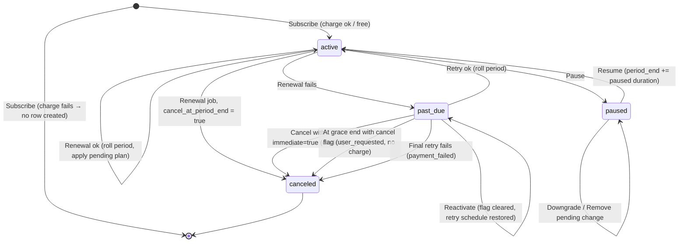

# SubCycle — Subscription State Machine

Status: Approved with revisions (Stage 0); updated for Stage 1. Consistent with [DECISIONS.md](DECISIONS.md); where this file and DECISIONS.md differ, DECISIONS.md wins.

## States

| State | Meaning | Access to usage |
|---|---|---|
| `active` | Paid up (or free) and within the current period | Yes |
| `paused` | User paused; no usage, no renewals | No (402) |
| `past_due` | Renewal charge failed; retrying within the grace window | Yes while `now < past_due_since + 3 days`, else No (402) |
| `canceled` | Terminal. History is kept; user may subscribe again (new row) | No (402) |

There is no `trialing`. "No subscription" is represented by the absence of a non-canceled row.

`cancel_at_period_end`, `pending_plan_id` are **flags**, not states.

## Diagram



## Transition table

"Guard" is checked after `SELECT … FOR UPDATE` on the subscription row. Any violation → **409** with code `INVALID_TRANSITION` (state problems) or **400** `VALIDATION_ERROR` (bad input, e.g. interval mismatch).

| # | Action | From | Guard (besides state) | To | Effects | Event(s) |
|---|---|---|---|---|---|---|
| 1 | Subscribe | none / only `canceled` rows | Plan exists. Paid: charge succeeds (two-phase) | `active` | New row; `period_start = now`, `period_end = now + 1 interval`; paid → paid `initial` invoice | `subscribed` |
| 2 | Upgrade | `active` | Same interval; higher price; charge succeeds if amount > 0 | `active` | `plan_id = target`; clears `pending_plan_id`; proration invoice if amount > 0; period unchanged | `upgraded` (+ `downgrade_cleared` if a pending plan was dropped) |
| 3 | Downgrade | `active`, `paused` | Same interval; lower price than current plan | same | `pending_plan_id = target` (replaces any existing) | `downgrade_scheduled` |
| 4 | Remove pending change | `active`, `paused`, `past_due` with `pending_plan_id` set | Pending change exists (else 409) | same | `pending_plan_id = NULL` | `downgrade_cleared` |
| 5 | Pause | `active` | — | `paused` | `paused_at = now` | `paused` |
| 6 | Resume | `paused` | — | `active` | `period_end += now − paused_at`; `paused_at = NULL`; no charge | `resumed` |
| 7 | Cancel (default) | `active`, `past_due` | Not already scheduled (else 409) | same | `cancel_at_period_end = true`; `cancel_requested_at = now`. **In `past_due` additionally** `next_retry_at = past_due_since + 72h` (grace end): retries stop, grace access is preserved | `cancel_scheduled` (meta has `grace_ends_at` in `past_due`) |
| 7b | Cancel immediately | `past_due` (body `{"immediate": true}`; 400 in any other state) | Explicit user opt-in | `canceled` | `canceled_at = now`; `cancel_reason = user_requested`; `cancel_requested_at = now`; clear `next_retry_at`, `past_due_since`, `retry_count`; `pending_plan_id = NULL`; access ends now | `canceled` (meta `immediate: true`) |
| 8 | Reactivate | `active` (flag set, `now < period_end`) or `past_due` (flag set, not finalized) | — | same | `cancel_at_period_end = false`; `cancel_requested_at = NULL`. In `past_due`: `next_retry_at = past_due_since + (retry_count + 1) days` | `reactivated` |
| 9 | Renewal (job) – cancel | `active` | `period_end <= now` and `cancel_at_period_end` | `canceled` | `canceled_at = now`; `cancel_reason = user_requested`; `pending_plan_id = NULL` | `canceled` |
| 10 | Renewal (job) – free | `active` | `period_end <= now`; next plan price = 0 | `active` | Roll period from old `period_end`; apply pending plan; no provider call | `renewed` (+ `downgrade_applied`) |
| 11 | Renewal (job) – paid ok | `active` | `period_end <= now`; charge succeeds | `active` | Roll period; apply/clear pending plan; paid `renewal` invoice | `renewed` (+ `downgrade_applied`) |
| 12 | Renewal (job) – fail | `active` | `period_end <= now`; charge fails | `past_due` | Failed invoice; `past_due_since = now` (clock at the failing Tx 2); `next_retry_at = past_due_since + 1 day`; `retry_count = 0`; period **not** extended | `renewal_failed` |
| 13 | Retry ok (job) | `past_due` | `next_retry_at <= now`; `cancel_at_period_end = false`; charge succeeds | `active` | Roll period from old `period_end`; invoice → paid; clear `past_due_since`, `next_retry_at`, `retry_count`; apply pending plan | `renewed` (+ `downgrade_applied`) |
| 14 | Retry fails (job) | `past_due` | `next_retry_at <= now`; charge fails; `retry_count + 1 < 3` | `past_due` | `retry_count += 1`; `next_retry_at = past_due_since + (retry_count + 1) days` (anchored, not drifting) | `renewal_failed` |
| 15 | Retry exhausted (job) | `past_due` | 3rd retry fails, **or** a job visit at `now >= past_due_since + 72h` with retries remaining makes one final attempt that fails | `canceled` | `canceled_at = now`; `cancel_reason = payment_failed`; `pending_plan_id = NULL` | `canceled` |
| 16 | Cancel finalized in past_due (job) | `past_due` with `cancel_at_period_end` | `next_retry_at (= grace end) <= now`, i.e. the first job visit at or after `past_due_since + 72h` | `canceled` | `canceled_at = now`; `cancel_reason = user_requested`; `pending_plan_id = NULL`; **no charge attempted**. Access was preserved for the full grace window | `canceled` |

Rows 13–15 apply only when `cancel_at_period_end = false`. Once a user has requested cancellation in `past_due`, **no further renewal charge is ever attempted**, and the 72-hour grace access is never cut short (except by the user's explicit row 7b).

### Rejected combinations (all → 409 unless noted)

| Action | From | Reason |
|---|---|---|
| Subscribe | `active`, `paused`, `past_due` | One non-canceled subscription per user (DB unique index also enforces) |
| Upgrade | `paused`, `past_due`, `canceled`, none | Only from `active` |
| Upgrade / Downgrade | any | Different interval → **400** `VALIDATION_ERROR`; not higher/lower price → **400** |
| Downgrade | `past_due`, `canceled`, none | Only from `active`, `paused` |
| Pause | `paused`, `past_due`, `canceled`, none | Only from `active` |
| Resume | `active`, `past_due`, `canceled`, none | Only from `paused` |
| Cancel | `paused` | User must resume first |
| Cancel | `canceled`, none; or already `cancel_at_period_end` | Nothing to cancel / already scheduled |
| Reactivate | `paused`, `canceled`, none; or flag not set; or (`active` and `now >= period_end`) | Cancellation already final or not scheduled |
| Cancel with `immediate: true` | any state except `past_due` | 400 `VALIDATION_ERROR` (immediate is only meaningful for a delinquent subscription) |
| Remove pending change | no pending change; `canceled` | Nothing to remove |

Missing subscription for a lifecycle action returns **404** `SUBSCRIPTION_NOT_FOUND`; Subscribe is the only action that expects no subscription.

## Flag interactions

| Combination | Behaviour |
|---|---|
| `pending_plan_id` + pause | Survives pause; applied at the first renewal after resume |
| `pending_plan_id` + `cancel_at_period_end` | Cancel wins; pending cleared when canceled |
| `pending_plan_id` + upgrade | Pending cleared (`downgrade_cleared`, reason `upgrade`) |
| `cancel_at_period_end` + pause | Flag survives; must resume before reactivating |
| `cancel_at_period_end` + upgrade | Allowed; flag survives |
| `cancel_at_period_end` + resume | Flag survives; cancellation takes effect at the extended `period_end` |
| `cancel_at_period_end` + `past_due` | Retries stop; finalized at grace end (row 16); reactivate allowed until then |
| `paused_at` | Always written in the same UPDATE as `status`, so `paused_at IS NOT NULL ⇔ status = 'paused'` (DB CHECK) holds in every path (see DECISIONS B3a) |

## Two-phase charge (used by rows 1, 2, 11, 12, 13, 14)

```
Tx1  lock sub FOR UPDATE → validate transition → compute amount → INSERT billing_operations(pending, key) → COMMIT
     (no tx)  provider.charge(amount, key)
Tx2  lock sub FOR UPDATE → re-validate expected state
        success → op=succeeded, apply state change, invoice, event
        failure → op=failed, failed invoice (if applicable), failure handling, event
Reconcile (pending > 5 min): provider.lookup(key) → resolve via Tx2 paths
```

## Proration (row 2)

```
remaining_ms  = current_period_end − now            (in ms, from stored timestamps)
total_ms      = current_period_end − current_period_start
amount_due    = max(0, round_half_up((new_price − old_price) × remaining_ms / total_ms))
```

Computed with `BigInt`: `round_half_up(a × r / t) = (2·a·r + t) / (2·t)` (integer division, with `a ≥ 0`, `r ≥ 0` after clamping `r` to `[0, t]`). Rounded once. If `amount_due = 0` → no provider call, no invoice (DECISIONS B2), plan still switches, event `upgraded` with `amount_cents: 0`.

## Access rule (single function, mirrored by API/middleware/frontend/tests)

```
hasAccess(sub, now):
  active    → true
  past_due  → now < sub.past_due_since + 72 hours
              (blocked at exactly +72h; the job still runs the final retry that is due at +72h)
  paused | canceled → false
```
